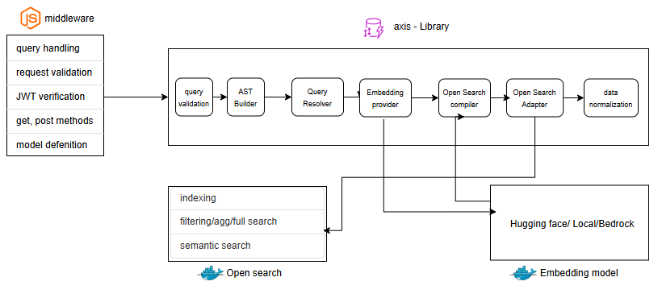
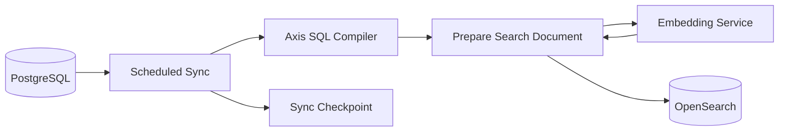
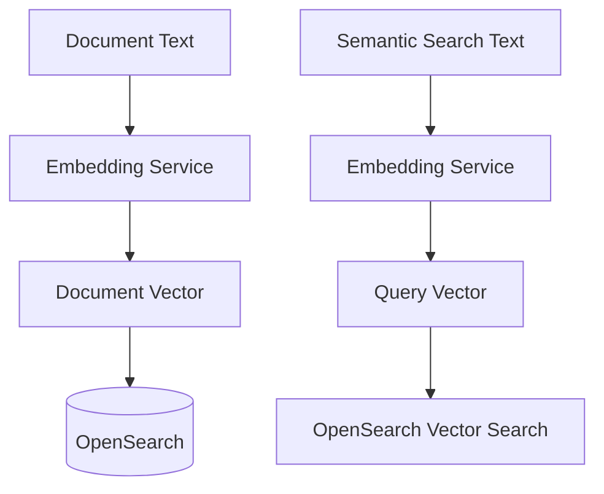
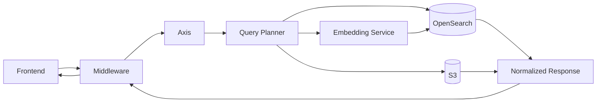
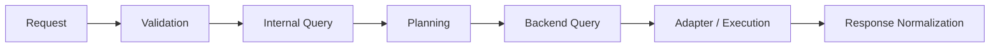
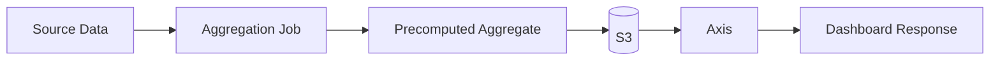

# AXIS — Data & Query Workflow

## 1. Purpose

The system has two separate flows:

- **Background flow:** PostgreSQL → scheduled sync → Axis SQL capabilities → document preparation → embedding service → OpenSearch.
- **Application flow:** Frontend → Middleware → Axis → query planning → OpenSearch / embedding service / S3 → normalized response.

PostgreSQL remains the source of truth. OpenSearch is the optimized read/search store. S3 stores prepared static aggregate data.



*Source: [`htmls/workflow.drawio`](htmls/workflow.drawio) — edit in diagrams.net, then re-export `workflow.png`.*

## 2. Background synchronization



The scheduled job should be incremental. It finds records that were added, updated, or deleted since the previous successful run.

For an updated record, Axis prepares the searchable document. If searchable text changed, the text is sent to the embedding service. The returned vector is stored with the document in OpenSearch.

For a deleted record, the corresponding OpenSearch document is removed.

The SQL compiler remains in Axis because the background process still needs SQL access to the source database. It does not need to run for normal frontend reads.

## 3. Embedding flow



The embedding service converts text into vectors. It does not require an LLM.

The same embedding model must be used when indexing documents and when converting a user's semantic query. This puts both vectors in the same vector space so OpenSearch can compare them.

## 4. Frontend request flow



The frontend only talks to the middleware. It does not need to know where the result is stored.

### Structured search and filtering

Filters, sorting, pagination, ordinary text search and supported aggregations can be sent directly to OpenSearch. No embedding service is required.

### Semantic search

For a semantic request, Axis sends the user's search text to the embedding service, receives a vector, and uses that vector for similarity search in OpenSearch.

### Static aggregate data

Prepared dashboard aggregates can be generated by a background job and stored in S3. Axis can retrieve those prepared results instead of recalculating them during every request.

## 5. Query planner

The query planner is the decision point inside Axis. It determines what type of backend operation the request needs.

```text
Request
   |
   v
Axis
   |
   v
Query Planner
   |
   +--> structured search/filter --> OpenSearch
   |
   +--> semantic search ---------> Embedding --> OpenSearch
   |
   +--> static aggregate --------> S3
```

The planner does not replace the compilers or adapters. It selects the appropriate path.

## 6. Transformation inside Axis



The request is validated, converted into Axis's internal representation, planned, compiled for the selected backend, executed, and normalized before being returned to middleware.

## 7. Static aggregate flow



Static or infrequently changing aggregates can be prepared ahead of time and stored in S3.

## 8. Component responsibilities

| Component | Responsibility |
|---|---|
| Frontend | Creates requests and displays responses |
| Middleware | HTTP, authentication, request context, model registration and response delivery |
| Axis | Query planning, compilation, indexing, OpenSearch access, embedding orchestration and normalization |
| Query Planner | Selects the appropriate data path |
| SQL Compiler | Reads source data for scheduled/background work |
| Embedding Service | Converts text into vectors |
| OpenSearch | Search, filters, aggregations and vector similarity |
| S3 | Prepared/static aggregate data |
| Scheduler | Runs background synchronization and aggregation jobs |
| PostgreSQL | System of record |

## 9. Architectural boundary

**PostgreSQL is the source of truth. OpenSearch is the optimized read/search store. S3 is the prepared aggregate store. Axis is the abstraction layer that hides these storage details from the middleware.**

The expensive work—indexing, embedding and aggregate preparation—happens in controlled background processes wherever possible. The normal user read path stays focused on fast retrieval.
