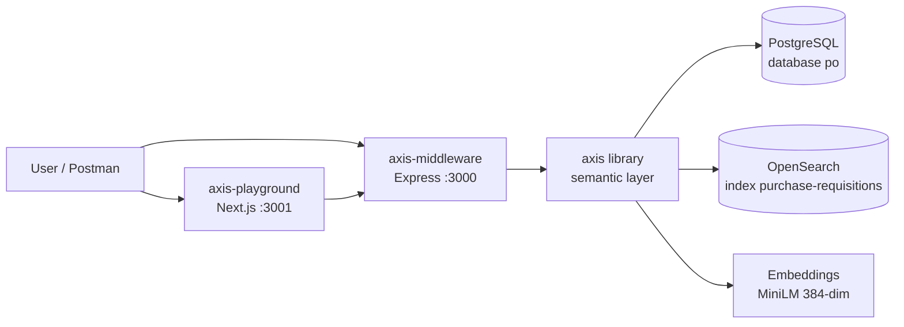

# Axis System — README

Governed analytics over PostgreSQL, served from OpenSearch, explored from the browser.
Three packages, one direction: **clients send JSON DSL, never SQL; HTTP reads hit
OpenSearch only.**



## 1. The three packages

| Folder | What it is | Port | Role |
|---|---|---|---|
| `axis/` | TypeScript library (`axis-1.0.0.tgz`) | — | Models, validation, AST, resolver, SQL + OpenSearch compilers, planner, indexer, security, cache, embeddings |
| `axis-middleware/` | Express API | 3000 | JWT auth, routes (`/search`, `/os/*`, `/models`), wiring (DB, OS, embeddings) |
| `axis-playground/` | Next.js UI | 3001 | Postman-in-the-browser: models, query builder, raw JSON, auth panel, response viewer |

Dependency direction is strict: `playground → middleware → axis → infrastructure`.
The library never sees JWTs; the UI never sees SQL; the middleware never builds DSL.

## 2. Prerequisites

- Node 20+, PostgreSQL with database `po`, OpenSearch + embeddings container reachable.
- Middleware `.env`:

```ini
DATABASE_URL=postgresql://postgres:<pass>@localhost:5432/po
AXIS_JWT_SECRET=axis-local-secret
OPENSEARCH_URL=http://<host>:9200
EMBEDDING_URL=http://<host>:8000
EMBEDDING_PROVIDER=openai-compatible
EMBEDDING_MODEL=sentence-transformers/all-MiniLM-L6-v2
EMBEDDING_DIMENSIONS=384
```

## 3. Build / run / test

```bash
# 1. library -> pack -> reinstall (REQUIRED after any axis/src change)
cd axis && npm run build && npm pack
cd ../axis-middleware && npm install file:../axis/axis-1.0.0.tgz

# 2. seed + index
npx tsx scripts/seed-po.ts                             # 8 PG rows, re-runnable
npx vitest run tests/e2e-searchAndFilter.test.ts        # bulk-indexes OS, asserts 13/13

# 3. serve
npm run build && npm start                              # middleware :3000
cd ../axis-playground && npm install && npm run dev     # playground :3001
npm run test                                            # middleware suite (273)
```

> Forgetting pack + reinstall leaves a stale `node_modules/axis` — the #1 phantom-error source.

## 4. API contracts

Auth (when `AXIS_JWT_SECRET` set): `Authorization: Bearer <JWT>`, spec claims
`{ sub, tenantId, roles? }` or legacy `{ userId, tenantId, role? }` → context
`{ user, tenant, roles }`. Tenant isolation is fail-closed: foreign tenants see zero rows.

| Endpoint | Auth | Purpose |
|---|---|---|
| `GET /health` | no | `{ ok: true }` |
| `GET /models` | no | registered models, axes, metrics |
| `POST /search`, `POST /search/:model` | yes | fulltext / semantic / hybrid search, filters, metric aggregations |
| `GET /os/indices` | yes | per-model index name + doc count |
| `GET /os/docs/:model?limit=&offset=` | yes | sample docs, vectors truncated, tenant-filtered |
| `POST /query/*`, `/cache/*` | — | **removed** (commented out): SQL-over-HTTP and caching are gone |

Response envelope: `{ data: { rows, rowCount }, meta: { model, limit?, offset? } }`.
Errors: `400` validation · `401` auth · `422` resolution · `503` not configured ·
`502` execution (cause in server logs) · `404` unknown route.

Example — grouped aggregation (answered from OS aggs, `size: 0`):

```json
POST /search
{ "model": "PurchaseRequisitions", "axes": ["department"], "metrics": ["newCount"], "limit": 10 }
→ { "data": { "rows": [{ "department": "Chemical", "newCount": 1 }, ...] } }
```

Type note: OpenSearch returns native numbers (`6`); the retired SQL path returned
numeric strings (`"6"`).

## 5. Models

**PurchaseRequisitions** → source `upeg.requisition_deails` (tenant-scoped). Axes: `id, status,
department, createdBy, amount, createdAt, hasAssignedBuyer`. Metrics: `newCount,
pendingCount, assignedCount`. Search: index `purchase-requisitions`,
`searchable`/`embeddingInput` = `["department"]`, vector field `embedding`.

Caveat: `hasAssignedBuyer` / `assignedCount` reference `upeg.requisition_item`,
absent from `po` — avoid until that table exists.

**Companies** → source `vendor_companies` view (shared catalog, 30 vendors).
Axes: `id, companyName, pan, gst, cin, msme, msmeType, msmeClassification,
turnover2324/2425/2526, contactName, contactNumber, email`. Metrics:
`totalCompanies, msmeCount, micro/small/mediumCount, turnoverTotal/Average/Min/Max/PrevTotal`.
Search: index `companies`, searchable/embedding input `["companyName", "contactName"]`.
Tenant term filters are skipped for this model (`openSearch.shared`); any valid
token sees all 30.

## 6. Companion docs

- `WORKFLOW.md` — data state at every pipeline stage, with Mermaid flows.
- `ARCHITECTURE.md` — components, dependencies, and decisions across all three folders.
- `OPENSEARCH.md` — OpenSearch usage deep-dive.
- `ISSUES_AND_IMPROVEMENTS.md` — known flaws and opinions.
- `htmls/` — themed HTML mirrors of each doc (diagrams render via Mermaid CDN).
