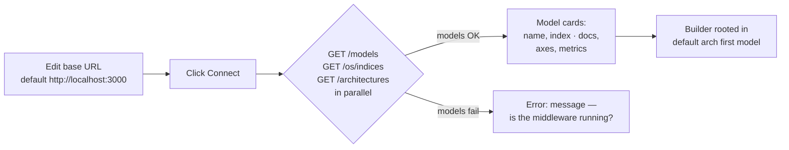
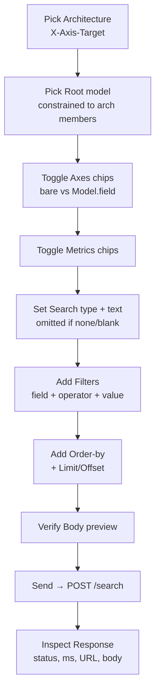
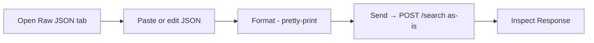
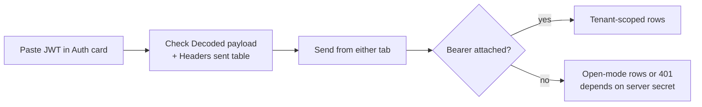
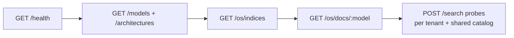

# UX Flows — Axis

Single-page browser tool (`axis-playground`, `:3001`) over the middleware API (`:3000`). There is no multi-page navigation, no signup/login page, no settings page, and no deep-linking: tab switches and selects are local state. All flows below are implemented as observed in `axis-playground/app/page.tsx`.

Related: [PRD](../01-prd/PRD.md) · [User stories](../02-user-stories/USER_STORIES.md) · [API spec](../06-api-spec/API_SPEC.md)

---

## 1. Navigation map

```text
/ (Axis Playground — one scrollable page)
├── header.top — title + Dark/Light toggle
├── .card Connection — base URL + Connect + model cards
└── .grid-2 (stacks to 1 column ≤ 1000px)
    ├── left: .card Query — tabs [Query Builder | Raw JSON]
    └── right: .card Auth + .card Response
```

No router, no links, no breadcrumbs, no sidebar. State defaults: `architecture "A2"`, `model "PurchaseRequisitions"`, `tab "builder"`, `searchType "none"`, `limit "10"`, `offset "0"`, token `""`.

## 2. Journey 1 — Connect and discover

**Goal:** Confirm the middleware is up and learn what can be asked.



Screen states:

- Before Connect: auto-Connect runs once on mount using the stored or default URL.
- Success: cards populate; architecture select fills; builder root set; `axis.baseUrl` persisted.
- Failure: error line under the button; models/indices cleared (architectures left as-is).
- Edge: indices unavailable but models OK → hint "Index counts unavailable — restart the middleware (it serves /os/indices) and hit Connect"; per-card `index: ? docs: ?`.

## 3. Journey 2 — Builder query (no code)

**Goal:** Group, filter, search, and send without writing JSON.



Key decisions and states:

- Changing architecture **clears** axes/metrics/filters/order-by (different member set).
- Changing root **rebases** references (`dept` ↔ `CompanyInfo.dept`) instead of dropping them; hint shows `root X joins Y,Z (1:N)` for multi-model archs.
- Axes/metrics sections render per member model with `(root — bare names)` / `(joined — sent as Model.field)` hints.
- Filter value box disables for `isNull`/`isNotNull`; `in`/`notIn` placeholder shows `[1, 2]`; values JSON-parsed when possible.
- Non-numeric limit/offset are omitted from the payload.
- `C` shows "(not implemented yet — expect 501)".
- Send disabled while `sending`; network failure shows `NETWORK ERROR` + timing; non-2xx shows red pill with the pretty-printed body.

## 4. Journey 3 — Raw JSON query

**Goal:** Reproduce an exact client payload.



States: Format silently no-ops on invalid JSON. Send with invalid JSON shows `Invalid JSON: …` (`status null`, no URL, no request). `X-Axis-Target` and `Authorization` headers are still attached exactly as in the builder.

## 5. Journey 4 — Authenticated query

**Goal:** Prove who you are and see only your rows.



States: empty token → `(no token — requests go unauthenticated)` + `Authorization (omitted)`; undecodable → `(not a decodable JWT)`; token preview shows `Bearer {first 18 chars}…`. Clear removes state and storage. Token persists across sends via `axis.token`.

## 6. Journey 5 — Operator inspection (API client, no UI)



Used for smoke tests, tenant-isolation checks (tenant-001 vs tenant-002 vs foreign), and index-freshness checks. Full field reference in [API spec](../06-api-spec/API_SPEC.md).

## 7. Edge cases across all journeys

| Situation | What the user sees |
|---|---|
| Middleware down | Connect error; Sends show `NETWORK ERROR`. |
| No models registered | No cards; selects empty; added filter/order rows get `field: ""`. |
| Unknown model/field in raw JSON | `422` with model/field message. |
| `search` sent but embeddings down | `502 Query failed. Check server logs.` |
| Search not configured (no `OPENSEARCH_URL`) | `503 Search is not configured.` |
| Architecture `C` | `501 Architecture "C" … not implemented. Retry with A2.` |
| Unknown `X-Axis-Target` | `400 Unknown architecture …`. |
| Malformed request JSON (API) | `400 InvalidJson`. |
| Expired/wrong-secret JWT | `401 JWT verification failed: …`. |
| Missing tenant/user context | `403 SecurityContextError` or zero rows (fail-closed). |
| Valid query, no matches | `200` with `rows: [], rowCount: 0`. |
| Oversized body (> 256 KB) | Rejected before validation. |
| Small screens | Two-column grid collapses to one; no other responsive behaviour. |

There are no toasts, skeletons, confirm dialogs, uploads, charts, or saved-query states. Result display is pretty-printed JSON only.
