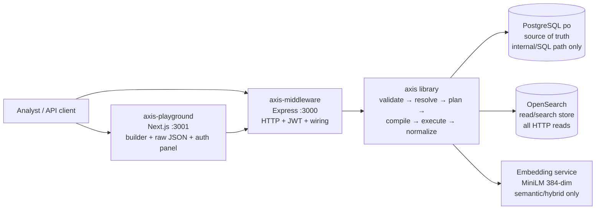
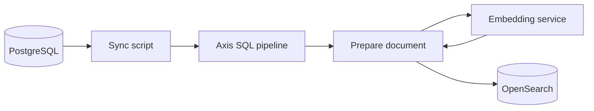
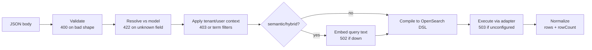

# Architecture — Axis (Product View)

High-level explanation of how the product behaves and who owns what. For code-level detail, see `axis-middleware/AXIS_ARCHITECTURE.md`, `AXIS_WORKFLOW.md`, and `REQUIREMENTS.md` in the repository.

Related: [BRD](../00-brd/BRD.md) · [PRD](../01-prd/PRD.md) · [Data model](../05-data-model/DATA_MODEL.md) · [API spec](../06-api-spec/API_SPEC.md) · [Security & privacy](../09-security-privacy/SECURITY_PRIVACY.md) · [Runbook](../13-operations/RUNBOOK.md)

---

## 1. System overview

Dependency direction is strict: **playground → middleware → axis → infrastructure**. The library never reads `process.env`, never sees JWTs, and never imports Express. The middleware never builds OpenSearch queries by hand. The UI never sees SQL.

## 2. Read / write separation (the core idea)

| Path | Flow | Purpose |
|---|---|---|
| **User read path** | Frontend → Middleware (CORS, auth, `X-Axis-Target`) → Axis (`searchDocuments`: validate → resolve → embed if needed → compile → adapter → normalize) → Response | Fast retrieval; the only path a user request takes. |
| **Background sync path** | Operator script / cron → Axis SQL pipeline → PostgreSQL → transform → embed → bulk index → OpenSearch `_refresh` | Keeps the search store current; never on the user request path. |

PostgreSQL is the source of truth. OpenSearch is the read-optimized copy. The embedding service converts text to vectors (no LLM required). S3 appears in the architecture as the future home of precomputed static aggregates (architecture `C`, currently `501` stubbed).

## 3. Components and responsibilities

| Component | Owns | Does not own |
|---|---|---|
| Playground | Base URL, builder state, raw JSON, token textarea + decode preview, response rendering, theme. | Auth enforcement, query compilation, secrets. |
| Middleware | Routing, CORS, body-size limit, JWT verification, `AxisContext` creation, `X-Axis-Target` parsing, model + relationship registration, Axis construction, error-to-HTTP mapping, shutdown. | Query compilation, embeddings, index mapping. |
| Axis library | Models/registry, validation, AST, resolver (single + joined), SQL + OpenSearch compilers, planner, adapters, indexer/transformer/bulk, embeddings providers, security resolver, (disabled) cache. | Tokens, HTTP, environment. |
| PostgreSQL | Transactional rows (`upeg.requisition_deails`, `company_info`, `financial_info`, `contact_details`, `vendor_companies` view, optional `requisition_item` stub). | Search ranking, vectors. |
| OpenSearch | Indices (`purchase-requisitions`, `companies`, `companyinfo`, `contactinfo`, `financialinfo`), text + keyword fields, `knn_vector` embeddings, filters, aggregations. | Authority — it is a copy. |
| Embedding service | Text → 384-dim vectors, same model at index and query time. | Business logic. |

## 4. Request lifecycle (product view)

Planner note: `DefaultQueryPlanner` and `axis.plan()` exist in the library but routes call `searchDocuments`/`query` directly — the planner is currently dead policy code (see `ISSUES_AND_IMPROVEMENTS.md`). Product behaviour is unaffected.

Caching note: the library cache (`MemoryCache`/`ValkeyCache`/`CacheManager`, security-aware keys) exists, but the middleware passes `cache: { enabled: false }`, so every request hits OpenSearch. `/cache/*` routes are removed.

## 5. Architectures and datasource routing

Middleware-owned (never hardcoded in the library):

| Architecture | Datasource | Models | State |
|---|---|---|---|
| `A` | `opensearch` | `Companies`, `PurchaseRequisitions` | Implemented (legacy single-model). |
| `A2` | `opensearch` | `CompanyInfo`, `ContactInfo`, `FinancialInfo` | Implemented, **default** when `X-Axis-Target` is empty. |
| `C` | `s3-json` | `CompanyInfo`, `ContactInfo`, `FinancialInfo` | Stubbed — returns `501`; retry with `A2`. |

Join topology (`A2`): `CompanyInfo.id 1:N ContactInfo.companyId`, `CompanyInfo.id 1:N FinancialInfo.companyId`. Joined references use `Model.field`; unrelated cross-model references return `422`.

## 6. Data ownership and isolation boundaries

| Data | Owner | Boundary |
|---|---|---|
| Transactional rows | PostgreSQL | Per-tenant (`tenant_id`) + per-user (`created_by`) columns on requisitions; constant `'public'` on the vendor view. |
| Search documents | OpenSearch indices per model | Tenant term filters for `purchase-requisitions`; no tenant filter for shared vendor indices (auth still required). |
| Vectors | Embedding service + index mapping | Dimensions (384) must match mapping; model must match between index and query time. |
| Sessions | PostgreSQL transactions (internal path) | `SET LOCAL`-equivalent session settings, never leak across pooled connections. |
| Secrets/config | Environment + operator | `AXIS_JWT_SECRET`, `DATABASE_URL`, OpenSearch/embedding URLs; never in client payloads. |

## 7. Retention and environment expectations

No retention, backup, or deletion policy is evidenced — **Needs confirmation** (see [Security & privacy](../09-security-privacy/SECURITY_PRIVACY.md)). Expected environments:

- **Local/dev:** all three parts on one machine, open mode (empty `AXIS_JWT_SECRET`), open CORS, demo seed data.
- **Pilot:** secret set, CORS restricted, real tenant IDs, stub/view DDL applied, indices rebuilt, embedding service pinned. See [Pilot plan](../12-pilot-rollout/PILOT_PLAN.md).

## 8. Key decisions (product impact)

1. Axis owns backend query translation; middleware owns HTTP/auth.
2. OpenSearch is behind Axis adapters — not a second semantic layer.
3. SQL stays in Axis for background sync; HTTP SQL removed.
4. Semantic search needs only an embedding model, not an LLM.
5. Documents are embedded at index time; only the query text is embedded per request.
6. Caching stays independent of OpenSearch — currently off by deployment choice, not by library limitation.
