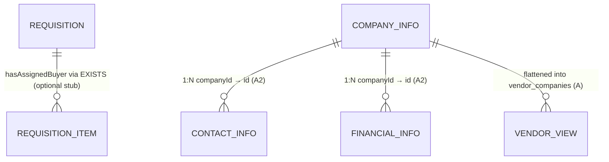
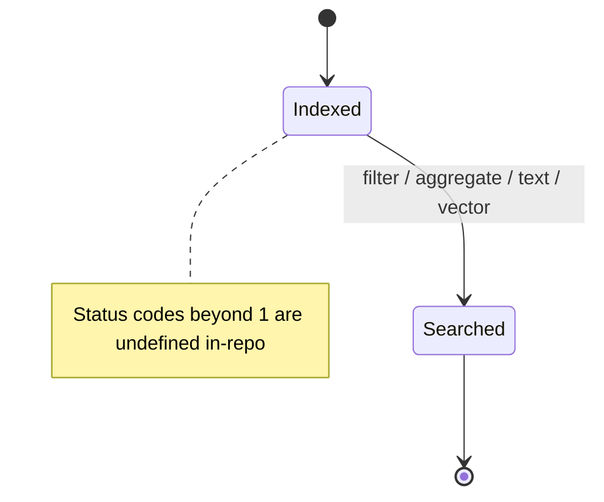

# Data Model — Axis (Product View)

What the product knows about, what each field means for users, and how long data lives. Code definitions live in `axis-middleware/src/models/*.ts` and `sql/*.sql`.

Related: [PRD](../01-prd/PRD.md) · [Architecture](../04-architecture/ARCHITECTURE.md) · [API spec](../06-api-spec/API_SPEC.md) · [Security & privacy](../09-security-privacy/SECURITY_PRIVACY.md)

**Conventions:** axis = group-by dimension (friendly name → column/expression). Metric = aggregation with an optional baked filter. `metric.sql` = database column (SQL path); `metric.search.field` = indexed axis key (OpenSearch path) — both are needed when names differ. Names are case-sensitive.

---

## 1. Entity overview

| Entity / model | Source | Index | Visibility |
|---|---|---|---|
| `PurchaseRequisitions` | `upeg.requisition_deails` table | `purchase-requisitions` | Tenant-scoped (each tenant sees only its rows). |
| `Companies` (legacy flat) | `vendor_companies` view (company + financial + contact LEFT JOINs) | `companies` | Shared catalog — any valid token sees all. |
| `CompanyInfo` (normalized) | `company_info` table, dataset `companyinfo` | `companyinfo` | Shared catalog. |
| `ContactInfo` | `contact_details` table, dataset `contactinfo` | `contactinfo` | Shared catalog. |
| `FinancialInfo` | `financial_info` table, dataset `financialinfo` | `financialinfo` | Shared catalog. |

Demo volumes: 8 requisitions (6 `tenant-001`, 2 `tenant-002`); 30 vendors per vendor table. Production volumes are **Needs confirmation**.

## 2. PurchaseRequisitions (tenant-scoped requisitions)

| Axis | Meaning | Type | Notes |
|---|---|---|---|
| `id` | Requisition ID (`requisition_id`) | string (PK) | Exact match. |
| `status` | Workflow status code | number | Only `1` has a codified meaning (pending, via `pendingCount`). Other codes: **Needs confirmation**. |
| `department` | Department name (`department_name`) | string | The only embeddable/searchable text today; drives semantic search. |
| `createdBy` | Owner (`created_by`) | string | Carries row ownership into the index for user-level filters. |
| `amount` | Amount (`amount`) | number | Numeric range filters; future sum/avg use. |
| `createdAt` | Creation time (`created_date`) | time | Time filters/grouping. |
| `hasAssignedBuyer` | Whether any item has a buyer-assignment date (`EXISTS … requisition_item … IS NOT NULL`) | boolean | Requires `upeg.requisition_item` (apply `sql/001_*` stub); otherwise execution fails. |

| Metric | Definition | Meaning |
|---|---|---|
| `newCount` | `count` | Requisitions in the selected period. |
| `pendingCount` | `count(requisition_id)` where `status equals 1` | Pending requisitions. |
| `assignedCount` | `count(requisition_id)` where `hasAssignedBuyer equals true` | Requisitions with an assigned buyer. |

Search config: `searchable: ["department"]`, `embeddingInput: ["department"]`, field `embedding`. Security: `function upeg.get_requisitions_for_user(userId)` (declarative hook) + engine tenant/user term filters.

Lifecycle: created in PostgreSQL → transformed → embedded (department text) → indexed. No delete/update flow or retention rule evidenced — **Needs confirmation**.

## 3. Vendor catalog — Companies (flat, architecture A)

Denormalized view row: company identity + MSME flags + three fiscal turnovers + primary contact + constant `tenant_id 'public'`.

| Axis | Meaning |
|---|---|
| `id` (`company_id`, PK, exact) | Vendor key — exact matches only. |
| `companyName`, `pan`, `gst`, `cin` | Identity and tax identifiers. |
| `msme` (`Yes`/`No`), `msmeType`, `msmeClassification` (`Micro`/`Small`/`Medium`) | MSME status. |
| `turnover2324` / `turnover2425` / `turnover2526` | Fiscal turnovers (`turnover_2023_24` …). Numbers. |
| `contactName`, `contactNumber`, `email` (`email_id`) | Primary contact. |

| Metric | Definition |
|---|---|
| `totalCompanies` | `count` — all vendors. |
| `msmeCount` | `count` where `msme equals "Yes"`. |
| `microCount` / `smallCount` / `mediumCount` | `count` where `msmeClassification` equals `Micro`/`Small`/`Medium`. |
| `turnoverTotal` / `turnoverAverage` / `turnoverMin` / `turnoverMax` | `sum`/`avg`/`min`/`max` of FY 2025-26 (`sql: turnover_2025_26`, `search.field: turnover2526`). |
| `turnoverPrevTotal` | `sum` of FY 2024-25 (`sql: turnover_2024_25`, `search.field: turnover2425`). |

Search config: `searchable` + `embeddingInput: ["companyName", "contactName"]`. Security: shared (`openSearch.shared: true`) — no tenant filter.

## 4. Vendor catalog — normalized (architecture A2 / C)

Same business facts split for joined search:

- **CompanyInfo** (`companyinfo`): axes `id` (exact PK), `companyName`, `pan`, `gst`, `cin`, `msme`, `msmeType`, `msmeClassification`; metric `totalCompanies`; searchable/embedding `companyName`.
- **ContactInfo** (`contactinfo`): axes `companyId` (exact PK/FK), `contactName`, `contactNumber`, `email`; metric `totalContacts`; searchable/embedding `contactName`.
- **FinancialInfo** (`financialinfo`): axes `companyId` (exact PK/FK), `turnover2324/2425/2526`; metrics `turnoverTotal/Average/Min/Max` (FY 2025-26); no searchable/embedding input (numeric only).

Relationships: `CompanyInfo.id → ContactInfo.companyId (1:N)`; `CompanyInfo.id → FinancialInfo.companyId (1:N)`. Joined reads use `Model.field` notation.

## 5. Field-type and search behaviour (user-visible)

- `id`-style axes are `keyword` (exact): use them as-is for exact ops.
- Other string axes are text + keyword: keyword search matches exactly; full-text matches analysed text; grouping/filtering uses the keyword variant.
- Numeric axes aggregate natively in OpenSearch (native JSON numbers in responses).
- The indexed field for an axis is `search.field ?? axis name`; the indexed field for a metric is `search.field ?? metric sql`. Mismatches silently aggregate the wrong field — model owners must keep both set (see [Runbook](../13-operations/RUNBOOK.md)).

## 6. Retention, ownership, isolation

| Question | Answer |
|---|---|
| Who owns definitions? | Middleware (`src/models/*.ts`); library only type-checks. |
| Who owns rows? | PostgreSQL. OpenSearch is a derived copy — re-index to reflect source changes. |
| Who owns vectors? | Embedding service output stored per document under `embedding`. |
| Tenant boundary? | `purchase-requisitions` filtered by `tenant_id` (+ user field); vendor indices unfiltered by design. `/os/indices` counts are cluster-wide. |
| Retention / deletion? | **Needs confirmation.** No retention, archival, or right-to-erasure workflow evidenced. Full re-index is the only refresh path (no `updated_at`, so incremental sync is impossible today). |
| Sensitive data? | `created_by` (email-like), contact names/numbers/emails, tenant IDs, and the debug snapshot `src/reference/indexed-docs.txt` — treat as sensitive. |
